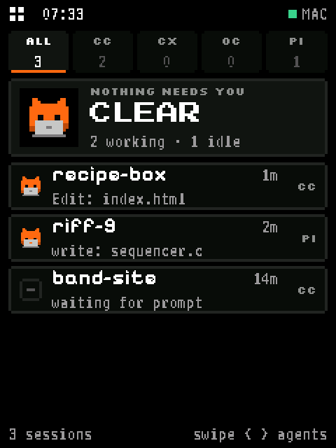
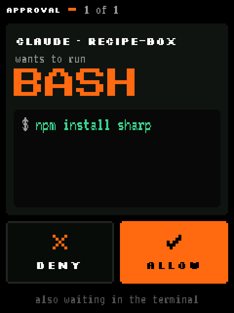
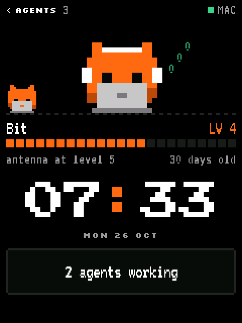

# ttycat firmware

ttycat puts your coding agents on a small touch screen on your desk. It shows which agents are working, which have finished, and which are waiting on you. When one asks to run a command or change a file, you can read the whole prompt and tap Allow or Deny.

This repo is the firmware for that screen. It's open source and made to be changed. You can add a screen, port it to another board, or build a different device that listens to your Mac, such as a lamp. You don't need to write the code yourself: the repo comes with instructions and skills for coding agents.

<p>
  
  
  
</p>

<!-- Real screens, drawn by tools/preview/preview.py with --scale 2: --scene busy --goto queue, --scene one --goto ask:a, and --scene busy --goto pet --grown 40. -->

It runs on the [Waveshare ESP32-C5-Touch-LCD-2.8](https://www.waveshare.com/esp32-c5-touch-lcd-2.8.htm), a 2.8" 240x320 board, and has been ported to the [Waveshare ESP32-S3-Touch-AMOLED-2.16](boards/waveshare-esp32-s3-touch-amoled-2-16). It shows Claude Code, Codex, OpenCode, Gemini, Pi and other agents, and answers Claude Code's prompts.

## How it fits together

```
 your agents ──> ttycat-daemon, on your Mac ──USB──> this firmware, on the board
                       ▲                                   │
                 ttycat-app runs it                   taps go back
```

The board doesn't run agents and has no network connection. About once a second the Mac sends it what to show, and the board sends back what you tapped. ttycat is three open-source repos:

| Repo | What it is |
|---|---|
| **ttycat-firmware** | This repo: the ESP-IDF firmware that draws the screens and talks to the Mac |
| [ttycat-daemon](https://github.com/ttycat-sh/ttycat-daemon) | The Mac's side. It finds your agents, carries your answers back and flashes the board. It's here as the `daemon/` submodule |
| [ttycat-app](https://github.com/ttycat-sh/ttycat-app) | The menu bar app, which runs the daemon and works without a board too |

## What's on the screen

| Screen | What you do there |
|---|---|
| **Queue** | Every session, the most urgent on top. Tap a tab or swipe sideways to filter by agent, and swipe up and down for more. Tap a session to open it. A session on another machine shows that machine's name |
| **Overview** | The grid icon, top left. One card per agent. **Next** goes to whatever needs you first |
| **Approval** | Allow or Deny. Deny ends the turn, like No in the terminal. If the text doesn't fit, it ends in `...`: swipe up to read all of it |
| **Question** | When Claude asks you something. Tap an option, or **Type an answer** for the keyboard, then **Send**. **Next** moves through several questions, and **Later** steps away and keeps your picks |
| **Needs you** | A prompt the board can't answer. **Open on Mac** brings that session's terminal forward |
| **Detail** | A session's recent events, and the switch to mute its chime. Swipe right to go back |
| **Home** | Bit, the time, and how your agents are doing. It appears after 30 s untouched, unless an agent is waiting on you or there's an error. The screen dims after 2 minutes, and the first touch only wakes it |

**Bit** lives on the home screen, and in the Mac app. You don't have to look after it. It grows a level at a time, from days passing and from how much your agents work, and it earns things to wear on the way. Allowing or denying never changes it. [docs/BIT.md](docs/BIT.md) has how it grows.

## You stay in charge

A screen that can approve what an agent does has to be careful. These rules hold in every screen, and in anything built on this repo:

- **Nothing approves by itself.** There's no auto-allow, timer or "allow all". Every Allow is one person deciding about one prompt.
- **You can only allow what you can read.** If a device can't show the whole command or diff, it may offer Deny or send the prompt to the Mac, but not Allow.
- **Deny always works.** It sits beside Allow and is never retried or softened.
- **Nothing rewards saying yes.** Answers earn no points, sounds or streaks, and Bit doesn't count them.
- **No accidental taps.** When a new prompt appears, taps don't count until they've stopped for 0.8 s, and never within 1.5 s of it appearing.
- **Your own builds ask first.** Only ttycat's signed releases can approve straight away. Any other build can deny and open sessions, but shows **On Mac** where Allow would be, until you allow that build in the Mac app's Setup.

[AGENTS.md](AGENTS.md) has the full rules, which coding agents working in this repo keep too.

## Putting it on a board

**With the app:** plug the board in, then go to Setup > Firmware > **Update board**. It takes about 10 seconds. Your agents keep running meanwhile, and you can answer them in the app or the terminal until the board is back. If an update fails partway, Setup offers **Reinstall firmware**. If even that can't reach the board, hold BOOT while plugging it in.

**By hand,** with [ESP-IDF 5.5](https://docs.espressif.com/projects/esp-idf/en/stable/esp32c5/get-started/index.html):

```sh
. ~/esp/esp-idf-v5.5.6/export.sh
idf.py -p /dev/cu.usbmodem1101 flash
```

Stop the daemon first, because it holds the serial port.

## Making it your own

```sh
git clone --recurse-submodules https://github.com/ttycat-sh/ttycat-firmware
cd ttycat-firmware
```

### With a coding agent

Open the repo with a coding agent and say what you'd like. [AGENTS.md](AGENTS.md) tells it how to work with you, including asking before it writes to your board. The skills in `.claude/skills` cover the common jobs:

| Skill | For |
|---|---|
| `ttycat-screen` | Changing a screen, or adding one |
| `ttycat-flash` | Putting a build on your board, and checking it works |
| `ttycat-new-board` | Running ttycat on a different ESP32 board with a touch screen |
| `ttycat-new-device` | Building something else that reacts to your agents, such as a lamp or a sign |

`ttycat-new-board` has been tried for real. An agent with only that skill ported ttycat to the AMOLED board, and [docs/ports](docs/ports) has how it went. `ttycat-new-device` has only been tried without hardware so far.

### See the screens without a board

You need only Python 3 and a C compiler. The preview builds the real screen code on your Mac and saves what it draws:

```sh
python3 tools/preview/preview.py out.png --scene asks --goto queue   # one screen
python3 tools/preview/gallery.py out.png --size 170x320              # every screen at one size
```

### Build and flash

```sh
. ~/esp/esp-idf-v5.5.6/export.sh
idf.py build                                              # the official board
idf.py -B build-amoled -D BOARD=waveshare-esp32-s3-touch-amoled-2-16 build
idf.py -B build-mine -D BOARD_DIR=$HOME/ttycat-boards/my-board build  # a board of your own
python3 daemon/tools/firmware_bundle.py build out         # pack a build
python3 daemon/ttycatd.py flash out --replace             # put it on the board, through the running daemon
```

`--replace` is there because flashing erases what's on the board, so only use it when you mean it.

A build from source calls itself something like `custom-0.11.5-a1b2c3d4`. The end comes from the source, so every change gets a new name, and the Mac app asks you again before that build can approve. Set `FW_LABEL` in `main/model.h` to put your own word first.

### Where things are

| Path | What |
|---|---|
| `main/` | What every board shares. `ui.c` has every screen, `gfx.h` the drawing, `link.c` the talking to the Mac, and `model.h` what the Mac sends |
| `main/board.h` | Everything the shared code needs from a board. It's versioned as `BOARD_API`, because boards outside this repo depend on it |
| `boards/` | One folder per board, plus `template` to start from. Nothing about particular hardware lives anywhere else. See [boards/README.md](boards/README.md) |
| `docs/PROTOCOL.md` | The messages between the Mac and a device, for building one of your own |
| `tools/preview/` | Screens as PNGs, with no board |
| `tools/tests/` | Tests that run on your Mac |
| `daemon/` | The Mac's side, as a submodule |

### Another board

Each board is a folder that provides a few functions: start up, show the picture, read touch and, if it can, chime. Everything else is shared, so a new board gets every screen and every update. Screens lay themselves out for anything from 170 to 480 pixels wide and 240 to 480 tall, with rounded corners if the glass has them.

Your own board lives in a folder of your own, outside this repo, so updating ttycat never touches it. Once you've flashed it with `ttycatd.py flash`, the Mac app builds each new ttycat release for it from your folder, and keeps your build allowed to approve if the folder hasn't changed. [boards/README.md](boards/README.md) has the details.

### A different device

Anything that speaks [docs/PROTOCOL.md](docs/PROTOCOL.md) over USB serial works with the Mac app: one JSON object per line, each way. It can be as small as an LED that lights up when an agent is waiting on you.

### Tests

```sh
python3 -m unittest discover -s tools/tests   # taps answer only the prompt on screen, and the colours match the daemon's
python3 tools/preview/unchanged.py            # every screen on every board, compared with the last commit
```

`unchanged.py` is for changes that shouldn't show, such as a fix for one board or tidying up. It draws every screen at every size and on every board, from your change and from the last commit, and lists the frames that differ.

CI runs these, checks that `main/` names no particular hardware, checks that no board's glass hides anything, and builds every board in `boards/`. The daemon's and the app's tests are in their own repos.

## Contributing

Issues and pull requests are welcome, for fixes, screens and docs. Please:

- keep the rules in [AGENTS.md](AGENTS.md);
- show what changed on screen with the preview, and run the tests and `unchanged.py`;
- keep board-specific code in its board's folder.

A board of your own stays in your own folder and isn't merged here: [boards/README.md](boards/README.md) says why, and how it still gets every update.

## Releases

A tag makes a release: `vX.Y.Z` for everyone, and `vX.Y.Z-dev.N` for testing. `.github/workflows/release.yml` then:

1. builds the official board's firmware in Espressif's ESP-IDF image, pinned by digest;
2. signs the firmware and this repo's source with the release key;
3. uploads them, never replacing a file;
4. offers them to Macs through the update server and, for a full release, attaches them to a GitHub release.

`FW_VERSION` in `main/model.h` must match the tag. Each version goes out once for testing and once for everyone: a rebuild isn't byte-for-byte the same, so a fix gets a new version. A board only says it's ttycat's own firmware when it runs a signed release, which the daemon checks against `daemon/release_keys.json` before writing it. The workflow builds and signs with `tools/release_firmware.sh`, which takes the key from `TTYCAT_SIGNING_KEY`.

## Open source, and Pro

Everything in the three repos is free and open source: seeing your agents, answering their prompts, notifications, the board and its firmware, and Bit. It's complete without anything else.

The official download of the app adds paid features, kept in a separate private repository: usage and limits, a log of what agents did, other machines, and skins. They connect through two small interfaces, `plugins.py` in the daemon and `Extensions.swift` in the app, and the open code never depends on them.

## License

Apache-2.0: see `LICENSE` and `NOTICE`. What the firmware builds on, and under which license, is in [THIRD_PARTY.md](THIRD_PARTY.md). The fonts are Press Start 2P, Silkscreen, Pixelify Sans and VT323, all under the SIL Open Font License (`tools/fonts/OFL-*.txt`).

The license doesn't cover the name "ttycat" or its logo. A board or device of your own can say it "works with ttycat".
